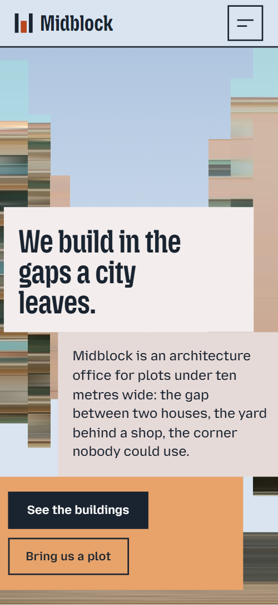
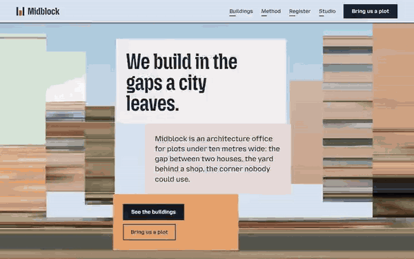

# Free HTML architecture website template with GSAP scroll animations — Midblock

**Website for an architecture office, with projects, method, team and an enquiry form: a free HTML template in one file, with GSAP scroll animations, no build step, MIT license. Made by [8B](https://8b.com/), the AI website builder.**

[](LICENSE)  

**[Live demo](https://8bsite.github.io/architecture-website-template/)** · **[Use this template](https://github.com/new?template_name=architecture-website-template&template_owner=8bsite)** · **[Download ZIP](https://github.com/8bsite/architecture-website-template/archive/refs/heads/main.zip)** · **[Template page on 8b.com](https://8b.com/templates/midblock/)**

<a href="https://8bsite.github.io/architecture-website-template/"></a> <a href="https://8bsite.github.io/architecture-website-template/"></a>

<p align="center"><a href="https://8bsite.github.io/architecture-website-template/"></a><br><sub>Scroll animation</sub></p>

A one-page site for a small architecture office that builds on narrow city plots, with its buildings, method, a register of plots, team and an enquiry form. Flat pastel blocks and street photos that start as streaks of smeared colour and come into focus as you scroll; the projects pass sideways like a walk along a street.

Good for: architecture or design office; architect's portfolio; urban planning or housing studio; construction or development company; any studio showing projects one by one plus a team.

## Use it with an AI coding agent

Download the files into your project (in Windows PowerShell type `curl.exe`):

```bash
curl -LO https://raw.githubusercontent.com/8bsite/architecture-website-template/main/index.html
curl -LO https://raw.githubusercontent.com/8bsite/architecture-website-template/main/AGENTS.md
curl -LO https://raw.githubusercontent.com/8bsite/architecture-website-template/main/LICENSE
curl -LO https://raw.githubusercontent.com/8bsite/architecture-website-template/main/CREDITS.md
```

Then give your agent this prompt:

```text
Read AGENTS.md, then edit index.html. Use this template as the base for a site for <your architecture office or studio: what you design, where, your projects with photos, your team, how to get in touch>. Keep the layout, the motion and the single-file format; replace the brand name, copy, photos, project data, the register table, team, address, links and contacts, and recolour it through the CSS variables if needed.
```

Give the agent the downloaded file, not a link: from a link it would rebuild a different page. No agent? Click **[Use this template](https://github.com/new?template_name=architecture-website-template&template_owner=8bsite)**, edit `index.html` and turn on **Settings → Pages**.

## What's on the page

- **Navigation** — top bar: wordmark, four section links, Bring us a plot button; phone menu overlay
- **We build in the gaps a city leaves.** — first screen: headline on stepped blocks between slabs of a street photo, then a manifesto and three short facts
- **Five buildings, none wider than a bus** — projects walked sideways: five buildings at their relative plot widths, each with a plate
- **We read a street for a whole day** — method in four steps beside a photo crossed by a red scan line
- **The gap register** — table of entries with status badges (demo: a public list of plots)
- **Borrowed colours** — six full-width colour bands, each with a name, a sentence and where it is used
- **What the neighbours said** — three testimonials on blocks at stepped heights, with one photo
- **9 Ropewalk, floor by floor** — one project floor by floor: a building photo cut into seven slices beside a list of seven levels
- **Five people, one long table** — team: five portraits at stepped heights with names and roles
- **Questions we hear on site** — questions and answers (native &lt;details&gt;)
- **Bring us a plot** — enquiry form between two street-photo slabs, then address, phone, email and hours
- **Footer** — colour bands, width-filling MIDBLOCK wordmark, links, address, copyright and the Design: 8B credit

## Design

Palette:              
Fonts: Mozilla Headline, Mozilla Text (Google Fonts). Change both through the CSS variables in the `:root` block at the top of `<head>`. A big display line with `style="--len:N"` fills its width: set N to its new number of characters.

- The smeared slabs in the opening and contact are one street photo stretched sideways with CSS: to change it, replace the same URL in all eight opening layers and both contact slabs. The floors section uses one photo for all seven slices, the scan section one photo twice.
- Project card widths and heights come from the inline style="--plot: N; --h: N" on each building: --plot is the plot width in metres, used as a relative width.

## Before you publish

- Replace everything marked `data-8b-placeholder` (social preview image, favicon, form, phone, email) and the invented demo facts: prices, dates, address. [AGENTS.md](AGENTS.md) lists them.
- The form sends nothing yet: connect it to Formspree or Netlify Forms, or remove it.

## Tech

GSAP 3.13.0, ScrollTrigger, Lenis 1.3.27 from jsDelivr, 93 KB, no build step. Chrome and Edge 108+, Safari 15.4+, Firefox 101+ (it uses cascade layers, small/dynamic viewport units). With "reduce motion" on, the page is complete and still.

## License

MIT, see [LICENSE](LICENSE); the "Design: 8B" footer link is welcome, not required. Photos, fonts and libraries keep their own licences: [CREDITS.md](CREDITS.md). More free templates: [8b.com/templates](https://8b.com/templates/) · [github.com/8bsite](https://github.com/8bsite).
